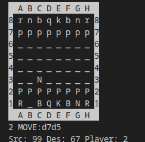
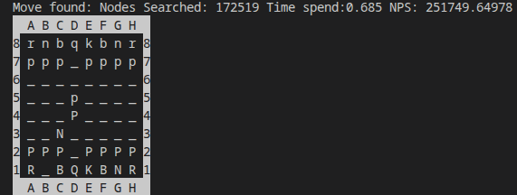

# Game in the terminal

Play against the engine in your terminal.

Build with the included Makefile:

```bash
make
```

**Build configuration:** GCC 16.2.1 (`-O2` optimization flag).

## Running

```bash
./main {player}
```

`1` plays as White and `2` plays as Black.

## Entering moves

Moves use **LAN (Long Algebraic Notation)**: the square the piece moves from, followed by the square it moves to. For example, `e2e4` moves the piece on e2 to e4.

## What you will see

**When you play,** the game shows the source and destination squares of your piece and which player you are. The squares are 0x88 board indices, so they differ from 64-square values (for example, `e2` is `20`).



**When the engine replies,** it shows the nodes searched, time spent and NPS.



## Perft

The source includes a `perft` function for testing move generation. The game doesn't call it, but you can use it if you edit the source.